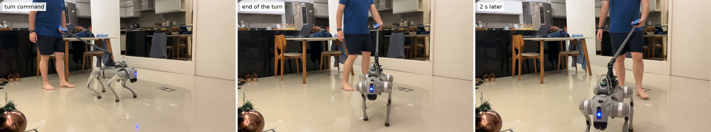
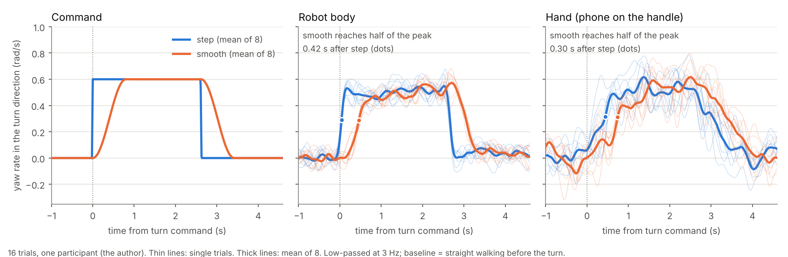
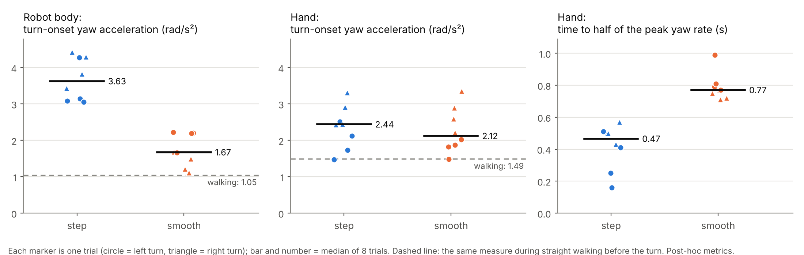

# Go2 guide-stick pilot: what reaches the hand when a quadruped turns?

A small engineering pilot on a Unitree Go2 EDU. A person holds a rigid stick hinged to the robot's
back, and the robot makes the same 90° turn with two command shapes: a **step** and a **smooth**
(cosine) ramp of the turn rate. A phone IMU on the handle, synchronized with the robot's IMU,
records what reaches the hand.

**Main observation (post hoc, one participant):** the smooth command more than halved how sharply
the robot's body started to turn, but at the hand it mostly delayed the cue. The hand's yaw rate
reached half of its peak 0.30 s later, and the turn started about as sharply at the hand with both
commands. Clarity and comfort ratings, given without knowing the profile, did not differ.


*Trial 8 (step profile, right turn) at the turn command, at the end of the turn and 2 s later.
The phone is taped to the stick near the hand.*

> **Scope:** one sighted participant (the author), eyes open, 16 trials in one session. This is an
> engineering pilot to learn the method. It is not a user study and says nothing yet about blind or
> low-vision users.

## Question

Guide robots for blind and low-vision people often use a rigid handle, and in a study with 18 blind
and visually impaired participants, users preferred a rigid handle and gradual turns
([arXiv:2501.04594](https://arxiv.org/abs/2501.04594)). Smoothing the turn command is the simplest
way to make a turn gradual. Does a smoother command change what the hand feels, or do the stick and
the gait already filter it?

## Setup

- **Robot:** Unitree Go2 EDU in sport mode, velocity commands through the Unitree SDK2 (Python) from
  the robot's Jetson Orin.
- **Stick:** carbon-fiber tube (Ø 27/25 mm, 1 m, 115 g) screwed into a printed PETG socket. A printed
  single-axis hinge leaves pitch free and locks yaw. The hinge base replaces the sensor mast on the
  robot's top plate. Parts and assembly notes are in [`cad/`](cad/).
- **Hand:** iPhone 14 taped to the tube near the hand, Sensor Logger app at 100 Hz (accelerometer,
  gyroscope, gravity). Hand yaw rate = phone angular velocity projected on the vertical axis.
- **Robot data:** IMU, joint torques and speeds, and battery power from `rt/lowstate` (~500 Hz);
  body state from `rt/sportmodestate` (~300 Hz).
- **Clock sync:** a knock pattern on the robot's top plate (3 knocks, pause, 2), seen by both IMUs at
  the start and at the end of the session. All 5 knocks matched at each end; the clock drift was
  70 ms over 20 min and is corrected linearly.

## Protocol

Each trial (~11 s, open loop): stand 1 s, accelerate to 0.3 m/s in 1 s, walk straight 2.5 s,
**turn 90°**, walk straight 1.5 s, decelerate 1 s, stand 1 s. Turn directions alternate left and right.

| Profile | Turn-rate command |
|---|---|
| step | 0 → 0.6 rad/s at once, held for 2.62 s |
| smooth | 0.8 s cosine ramp up to 0.6 rad/s, plateau, 0.8 s ramp down (same 90°) |

16 trials: 8 per profile, 4 per profile and direction, in an order randomized with a fixed seed (7).
The profile was not shown on screen. After each trial, the participant rated cue clarity and comfort
from 1 to 7. Session: 23 November 2026, indoors, on a tiled floor.

## Results

### Planned analysis

The analysis was written before the session and is fixed in commit `52f948a` (a git commit, not a
formal pre-registration). Code: `analyze_pilot.py`. Full table and definitions:
[`data/s1/results/summary.md`](data/s1/results/summary.md). Median [IQR], 8 trials per profile:

| profile | hand jerk added (m/s³) | peak hand accel. (m/s²) | hand lag behind robot (s) | hand cue onset (s) | joint work above walking (J) |
|---|---|---|---|---|---|
| step | 6.89 [1.06–12.18] | 3.42 [3.14–3.80] | 0.27 [0.22–0.29] | 0.19 [0.06–0.37] | 9.05 [5.39–12.32] |
| smooth | 6.26 [0.78–10.16] | 3.38 [3.36–3.70] | 0.28 [0.23–0.33] | 0.36 [0.15–0.42] | 4.04 [−2.94–18.75] |

None of these separated the two profiles clearly. The differences in hand jerk and peak hand
acceleration are small compared with the spread between trials. The cue onset (hand yaw rate
≥ 0.1 rad/s for 0.25 s) and the joint work differ in the pooled medians, but both differences change
sign between left and right turns.

### Post-hoc analysis

These metrics were defined after looking at the data, so they are exploratory. They come from
[`make_figures.py`](make_figures.py), a second, independent implementation of the clock sync and
signal extraction. All signals are low-passed at 3 Hz and measured from the turn command.


*Yaw rate in the turn direction, aligned at the turn command. The step's sharp start is clear at the
robot but not at the hand, where the smooth cue arrives about 0.3 s later.*



| median [IQR], 8 trials per profile | step | smooth |
|---|---|---|
| robot: turn-onset yaw acceleration (rad/s²) | 3.63 [3.13–4.28] | 1.67 [1.42–2.19] |
| hand: turn-onset yaw acceleration (rad/s²) | 2.44 [2.03–2.61] | 2.12 [1.86–2.66] |
| robot: time to half of the peak yaw rate (s) | 0.06 [0.05–0.06] | 0.47 [0.46–0.50] |
| hand: time to half of the peak yaw rate (s) | 0.47 [0.37–0.50] | 0.77 [0.74–0.80] |
| cue clarity, 1–7: median (range) | 7 (5–7), 7 ratings | 7 (6–7) |
| comfort, 1–7: median (range) | 6 (5–7) | 6 (5–6) |

- **Robot:** the smooth command more than halved the turn-onset yaw acceleration (1.67 vs 3.63 rad/s²)
  and shifted the turn by 0.41 s, as commanded.
- **Hand:** the turn-onset yaw acceleration was similar (2.12 vs 2.44 rad/s²) and not far above the
  gait sway measured the same way during straight walking (1.49 rad/s²). On the mean curves, where
  the sway averages out, it was 1.62 (smooth) vs 1.42 rad/s² (step), against 1.41 vs 3.62 at the robot.
- **Delay:** the smooth cue reached half of its peak 0.30 s later at the hand. Half of the plateau,
  or a fixed 0.3 rad/s threshold, gives the same 0.30–0.32 s.
- The direction of each difference is the same within left turns and within right turns, but the
  size varies: the hand delay was 0.47 s in left turns and 0.24 s in right turns
  ([`figures/posthoc_summary.txt`](figures/posthoc_summary.txt)).

**Tentative interpretation:** the stick, hinge, arm and trot seem to act as a low-pass filter. The
sharp start of the step command does not reach the hand, so smoothing the command mainly delays the
cue. If this holds, the coupling decides what the hand feels as much as the command does. A next step
is to test sticks of different stiffness, measuring both the turn cue and the gait vibration at the
hand.

## Limitations

- One participant (the author), sighted, eyes open and aware of the hypotheses; 8 trials per
  profile in one session. Descriptive statistics only.
- The phone measures the rotation of the handle, not forces or what the hand perceives. There was
  no force or torque sensor.
- The ratings were given without knowing the profile, but by the person who built the setup, and
  they sit near the top of the scale.
- The commands are open loop. The robot under-turned to the right (63–70° vs 87–93° to the left)
  and drifted about 2–3°/s to the left when walking straight, equally for both profiles.
- One rigid stick, one speed (0.3 m/s), one turn rate (0.6 rad/s), one floor. The stiffness of the
  stick and the play of the hinge were not measured.
- The post-hoc metrics were chosen after seeing the data, and the per-trial hand onset acceleration
  is close to the gait-sway level.

## Safety

Low speeds with hard caps in the script (0.5 m/s and 1.0 rad/s), `StopMove` on every exit path,
the remote control in hand, eyes open and a clear indoor area. The robot's obstacle avoidance was
switched off for the trials, because it alters velocity commands, and switched back on afterwards.
The change is recorded in the session notes.

## Reproduce

```bash
pip install numpy pandas scipy matplotlib
python3 analyze_pilot.py data/s1 --robot-knock-floor 0.5   # planned analysis -> data/s1/results/
python3 make_figures.py data/s1                            # post-hoc metrics and figures -> figures/
```

`go2_turn_pilot.py` runs the trials on the robot. Its `dry`, `check` and `sync` modes do not move
the robot; `run` does. Read the safety notes in the script before using it.

## Repository

| path | content |
|---|---|
| `go2_turn_pilot.py` | robot control and logging |
| `analyze_pilot.py` | planned analysis |
| `make_figures.py` | post-hoc metrics and the figures in this README |
| `cad/` | printed parts (STL and OpenSCAD) and assembly notes |
| `tools/` | helpers for the robot computer, the session checklist and the notes template (in Portuguese) |
| `test/` | offline tests: simulated sessions for the analysis and a fake Unitree SDK for the control script |
| `data/s1/` | trial list, per-trial event times, sync metadata, notes (in Portuguese) and results; the raw robot and phone CSVs are not in git |
| `figures/` | figures and post-hoc tables |

## How this was made

I planned this pilot together with Claude (Anthropic). I built and assembled the hardware, ran the
robot and held the stick in every trial. Most of the code was written with Claude Code under my
direction and tested before the session. A separate Claude session reimplemented the analysis to
cross-check it, made the figures and drafted this README, which I reviewed.

## License

MIT, see [LICENSE](LICENSE).

---

Jorge Metri Miranda · M.Sc. student in Electrical Engineering, Federal University of Espírito Santo
(UFES), Brazil · [LinkedIn](https://www.linkedin.com/in/jorge-metri-miranda)
